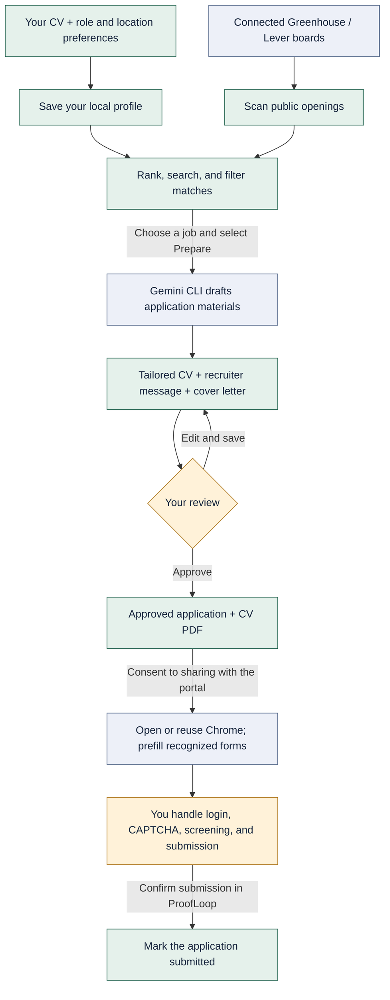

<div align="center">

# ProofLoop

**Better-fit jobs. Evidence-backed drafts. You make the final call.**

A local career copilot that turns your CV into a focused job search,<br>
reviewable application materials, and a human-controlled application workflow.

**Bun** · **HTMX** · **SQLite** · **Gemini CLI** · **Chrome**

[Quick start](#quick-start) · [How it works](#how-it-works) · [Dashboard guide](#dashboard-guide) · [CLI](#cli-reference) · [Privacy](#privacy-and-data)

</div>

---

> [!IMPORTANT]
> ProofLoop assists; it does not apply on your behalf. Review every generated claim, approve the documents yourself, and complete login, CAPTCHA, screening questions, and final submission manually.

## What you get

| Capability | What it does |
| --- | --- |
| **One master CV** | Extract text from PDF, DOCX, TXT, or Markdown, or paste your career history directly. |
| **A focused job inbox** | Scan public Greenhouse and Lever company boards and rank openings against your CV, target roles, and locations. |
| **Reviewable drafting** | Use your authenticated Gemini CLI to draft a tailored CV, recruiter message, and cover letter with instructions to use only supported facts. |
| **Clean CV PDFs** | Download a single-column PDF with selectable text, standard headings, and Unicode support. |
| **Human-controlled handoff** | Open installed Chrome, fill recognized empty fields, and attach the approved CV only when you choose Assisted apply. |
| **A local dashboard and CLI** | Search, filter, skip, restore, review, approve, and track applications without a hosted account. |

**Match scores are heuristics, not an ATS certification or a prediction of hiring success.** The score allocates up to 50 points to role alignment, 40 to CV-supported job terms, and 10 to location alignment.

## How it works



Scanning, drafting, and assisted apply are user-triggered. If Chrome encounters login or CAPTCHA, complete it yourself and retry **Assisted apply** on the same tab. Unrecognized forms and different-site redirects may require manual completion.

Application states are **Draft → Approved → Submitted**. The last transition records your confirmation; it never presses a portal's Submit button.

## Quick start

### 1. Check prerequisites

- **[Bun](https://bun.sh) 1.4.4 or newer** — ProofLoop's package manager, runtime, and test runner.
- **Git** — to clone the repository; your GitHub account needs access if it is private.
- **Gemini CLI** — available as `gemini` on your PATH and authenticated with your Google account.
- **Installed Google Chrome** — required for assisted apply and browser integration tests, not for basic dashboard browsing.

If Gemini CLI is not installed, install its package through Bun, then sign in interactively:

```bash
bun add --global @google/gemini-cli
gemini
```

Gemini CLI is an external tool with its own upstream runtime requirements. ProofLoop invokes your existing installation; it does not manage your Google login.

> [!NOTE]
> ProofLoop does not require a Gemini Developer API key. Access, quotas, and subscription eligibility depend on your Google account and CLI authentication method; an existing subscription is not a guarantee of unlimited usage.

### 2. Install and run

```bash
git clone https://github.com/vedantparmar12/proofloop.git
cd proofloop
bun install --frozen-lockfile
bun run dev
```

Open **[http://127.0.0.1:3000](http://127.0.0.1:3000)**.

For a server without file watching, use `bun run start`. Keep the server terminal open while using the dashboard or CLI.

### 3. Make your first application draft

1. Open **Profile & sources**, add your CV and preferences, and select **Save profile**.
2. Connect a real company's Greenhouse or Lever board using its board slug.
3. Open **Jobs** and select **Scan sources**.
4. Inspect a relevant opening and select **Prepare**.
5. In **Review**, verify the generated materials, edit them, and approve only when ready.
6. In **Applications**, download your CV PDF or explicitly choose **Assisted apply**.
7. Submit in the job portal yourself, then use **Confirm submitted** to update your tracker.

## Dashboard guide

### Profile & sources

- Enter contact details, comma-separated target roles and locations, and a minimum match threshold.
- Paste your master CV or upload **PDF, DOCX, TXT, or MD**, up to **8 MB**. PDFs must have selectable text and no more than **20 pages**; OCR is not included.
- Uploading extracts text into the editor; **review the extracted text and save your profile** to persist it.
- Select Greenhouse or Lever and enter the company's board slug, not its full URL. A slug is the company identifier in the board's address; it may differ from the display name.
- Profile preferences affect subsequent scans; scan again after changing them to refresh rankings.

### Jobs

- Search by **title or company**.
- Switch between **Open matches**, **All jobs**, and **Skipped**.
- Enable **Above my threshold** to include scores at or above your saved minimum.
- Use **View** to read the description, **Skip** to hide an opening from the open inbox, or **Restore** to bring it back.
- Preparing an application sends your CV/profile details and the selected job description to Gemini. An existing application prevents preparing a duplicate for that job.

### Review

- Edit the **tailored CV**, **recruiter message**, and **cover letter**. Generated text is a draft, not verified evidence.
- **Save edits** saves only that application. **Approve application** validates and saves the current form before approval.
- Check dates, employers, skills, metrics, contact details, and the downloaded PDF before approval. Approved applications are no longer editable in the current UI.
- The dashboard warns before navigating away from unsaved profile or draft edits.

### Applications

- **CV PDF** downloads the document; **Open job** opens the original posting.
- **Assisted apply** is available only for approved applications. It opens a visible, separate Chrome profile and reuses that application's tab on retries.
- Prefill requires one unambiguous CV upload input in a recognized form. It fills only empty, editable, recognized contact or cover-letter fields and preserves existing values and selected attachments.
- Review every field in Chrome. Screening answers, consent checkboxes, and submission remain your responsibility.
- The recruiter message is a draft for you to copy and send; ProofLoop does not automatically contact recruiters.

> [!WARNING]
> Assisted apply shares contact details, the reviewed cover letter, and your CV with the portal. File attachments may upload immediately, before final submission. Use it only where you have permission and automated prefill is permitted.

## CLI reference

Run these commands from the project root **while the local server is running**. Replace placeholders with IDs from your dashboard or CLI output.

| Command | Purpose |
| --- | --- |
| `bun run cli status` | Summarize jobs, matches, drafts, approvals, and submissions. |
| `bun run cli scan` | Scan connected public job boards. |
| `bun run cli list` | List up to 30 open jobs, their scores, and IDs. |
| `bun run cli prepare <job-id>` | Create a draft for one job. |
| `bun run cli approve <application-id>` | Approve the saved draft after your review. |
| `bun run cli assist <application-id>` | Open or retry an approved application's Chrome handoff. |
| `bun run cli submitted <application-id>` | Record submission after you have verified it in the portal. |

CLI commands are direct API actions and do not display the dashboard's confirmation dialogs. Approve only reviewed materials, obtain permission before sharing documents, and never mark submitted before verifying the actual portal submission. Unlike dashboard approval, CLI approval uses the draft already saved on the server.

### Claude skill

The project includes [`.claude/skills/job-agent/SKILL.md`](.claude/skills/job-agent/SKILL.md) for a compatible Claude skill client. It documents the CLI workflow and requires explicit human approval and permission to share application data. The skill uses the same running local service; it does not add a separate application engine.

## Configuration

Defaults work without an `.env` file. If needed, set environment variables or create a local `.env` file, which Bun loads and Git excludes:

```dotenv
PORT=3000
DATA_DIRECTORY=.data
PROOFLOOP_URL=http://127.0.0.1:3000
```

| Variable | Used by | Meaning |
| --- | --- | --- |
| `PORT` | Server | Local listening port; defaults to `3000`. |
| `DATA_DIRECTORY` | Server | SQLite, generated PDFs, and persistent Chrome profile location; defaults to `.data` relative to the working directory. |
| `PROOFLOOP_URL` | CLI | Address of the running service; update it if you change the server port. |

The server binds to `127.0.0.1`. Start commands from the project root. If you move `DATA_DIRECTORY`, exclude the new location from Git before storing personal data there.

## Privacy and data

**Local-first does not mean offline.** Your records stay on your machine, but scanning, drafting, and assisted apply have explicit network boundaries.

| Data or action | Destination |
| --- | --- |
| Profile, job records, application text, and statuses | Local `.data/proofloop.sqlite`. |
| Generated CV PDFs | Local `.data` directory. |
| Assisted browser cookies and sessions | Separate local `.data/chromium-profile` directory, not your everyday Chrome profile. |
| Public job scans | The configured Greenhouse or Lever board APIs. |
| Draft generation | Gemini through your installed, authenticated CLI. |
| Assisted prefill and attachments | The job portal opened in Chrome. |

`.data/`, `.env`, `node_modules/`, and `*.log` are excluded from Git. Protect local backups too: the data directory contains personal documents and browser session information. Stop the app and its assisted Chrome session before backing up the entire data directory.

There is no multi-user authentication or production hosting setup. **Do not expose this local service publicly or through an unauthenticated tunnel.**

## Development and tests

```bash
bun run dev                  # Bun server with file watching
bun run start                # Bun server without file watching
bun run test                 # Bun tests with per-file isolation
bun audit                    # Dependency vulnerability audit
```

Use `bun run test` rather than bare `bun test`: the script enables `--isolate` so temporary database state does not leak between test files. Install Chrome before running the browser tests.

Coverage includes matching, feed normalization, Unicode PDF extraction, escaped HTML fragments, dashboard editing and approval, and conservative assisted prefill. Integration tests use temporary databases, fixture job feeds, and a fake Gemini executable. They do not call live Gemini or submit real job applications.

<details>
<summary><strong>Project structure</strong></summary>

```text
proofloop/
├── .claude/skills/job-agent/  Claude skill instructions
├── public/                   Dashboard shell, CSS, and HTMX event glue
├── src/
│   ├── server.js             Local Express server, JSON API, and HTML fragments
│   ├── views.js              Escaped server-rendered dashboard templates
│   ├── db.js                 SQLite records and application states
│   ├── connectors.js         Greenhouse and Lever feed adapters
│   ├── matcher.js            CV-supported heuristic job ranking
│   ├── gemini.js             Gemini CLI prompts and validated draft output
│   ├── documents.js          CV text extraction and PDF generation
│   ├── assistedApply.js      Visible Chrome sessions and conservative prefill
│   └── cli.js                Local API command-line client
├── test/                     Rendering, document, and browser regression tests
├── bun.lock                  Reproducible dependency resolution
└── package.json              Bun commands and dependencies
```

The HTMX dashboard receives HTML fragments from Express; the CLI uses the same server's JSON API. HTMX is served locally from the installed dependency, not a CDN.

</details>

## Troubleshooting

| Symptom | What to check |
| --- | --- |
| CLI reports `fetch failed` | Start `bun run dev`; ensure `PROOFLOOP_URL` matches the server port. |
| Gemini is missing or unauthenticated | Check `gemini --version`, run `gemini` interactively, sign in with Google, and retry. |
| Gemini times out or returns an incomplete draft | Check your CLI session and quota, then retry. Draft generation has a 120-second timeout. |
| No jobs appear | Add a valid Greenhouse/Lever company slug, inspect scan errors, and relax the search/status/threshold filters. |
| Uploaded PDF has no usable text | Use a selectable-text PDF, DOCX, TXT, or Markdown CV; scanned-image OCR is not supported. |
| Chrome cannot launch | Install Google Chrome; assisted apply uses Playwright's `chrome` channel, not a bundled browser download. |
| Assisted apply pauses for login or CAPTCHA | Complete it yourself in the opened tab, navigate to the application form, then select Assisted apply again. |
| Form is unrecognized or the tab changes sites | Complete the portal manually; ProofLoop will not guess fields or follow a different-site handoff automatically. |

## Current boundaries

- Discovery supports **public Greenhouse and Lever company boards**, not platform-wide search or LinkedIn/Naukri-specific integrations.
- Scans are manual. There is no scheduled background search, mass application sending, email automation, or WhatsApp integration.
- There is no CAPTCHA solving, stealth browser behavior, automated screening, or final portal submission.
- Drafts require fact-checking; PDF formatting and match scores cannot guarantee ATS acceptance or interviews.
- The server runs on your computer and stops being available when that computer is off.

---

<div align="center">

**Find the fit. Verify the facts. Stay in control.**

</div>
